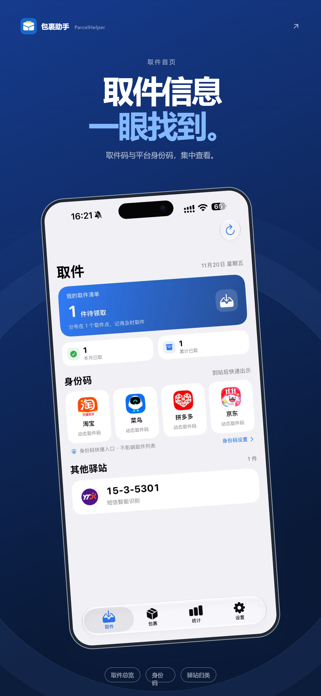
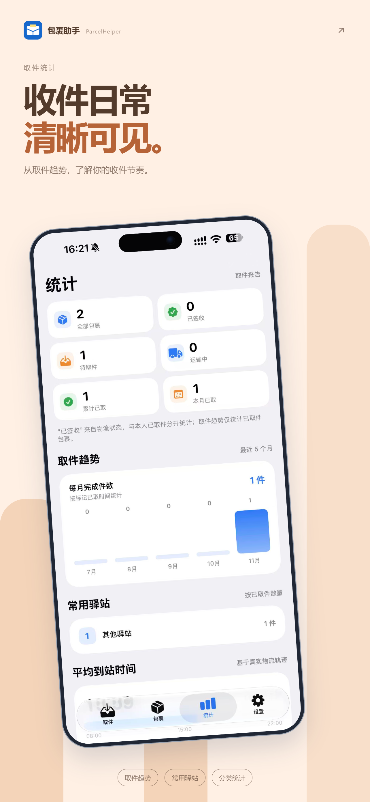
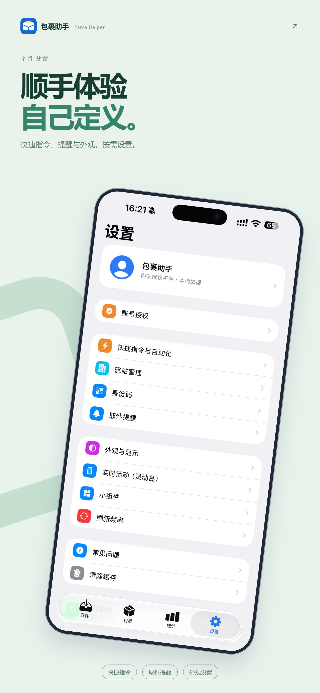
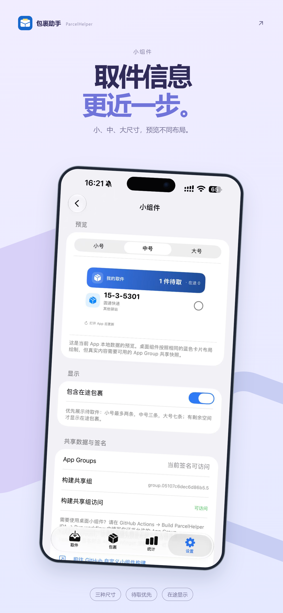

# ParcelHelper for iOS

[中文更新日志](CHANGELOG.md) · [小组件自签说明](docs/widget-signing.md)

一款使用 **Swift 和 SwiftUI** 构建的开源 iPhone 快递管理工具，帮助整理取件码、查看已授权平台的订单与物流轨迹，并管理待取、运输中、已签收和已取件的包裹。

项目参考了 [Scripting 版「包裹助手」](https://t.me/scripting_app/913) 的交互、短信解析和部分物流同步思路，采用原生 iOS 界面重新实现；**不是原 Scripting 工程的完整 1:1 复刻**，也不是菜鸟、淘宝或任何快递公司的官方应用。

## 应用宣传

以下为 `docs/screenshots/` 中的宣传图（PNG），展示取件、包裹、统计、设置、账号授权与小组件等核心界面；图中手机号、详细地址、运单号等敏感信息已脱敏。在 GitHub 中点击可查看原图。

  
  
  
  
  
  

## 主要功能

| 模块             | 功能说明                                                                                                  |
| ---------------- | --------------------------------------------------------------------------------------------------------- |
| 包裹管理         | 取件码、运单号、驿站、备注、轨迹；待取 / 在途 / 签收 / 取件状态；搜索、编辑与手动标记已取                 |
| 平台同步         | 登录授权后尝试读取淘宝、京东订单网页物流；菜鸟、拼多多、丰巢及小米快递聚合使用各自支持的会话与接口        |
| 短信与剪贴板识别 | 取件短信及复制的 SF / ZT / JT 等前缀运单号可确认导入；不自动将纯数字识别为运单，也不能读取短信数据库        |
| 物流提醒         | 前台同步识别派送、到站、签收等事件后发送本地通知（非 24 小时云端实时推送）                                |
| 统计与驿站       | 取件趋势、常用驿站、在轨迹数据可用时的到站时间统计；驿站支持展开式卡片编辑、关键词匹配与自动识别          |
| 实时活动与小组件 | 灵动岛、锁屏实时活动及主屏幕小 / 中 / 大 WidgetKit 组件；显示本地包裹快照，App Group 共享依赖实际签名授权 |
| 软件更新         | 前台定期检查 GitHub Releases、显示更新说明、下载 IPA 并交给 LCSign 等签名工具安装                         |
| 运行日志         | 「设置 → 运行日志」查看最近 240 条同步阶段、数量与失败分类，可复制/清空；不采集账号凭据或完整运单信息     |
| 本地保存         | 包裹数据默认保存在 App 沙盒 Documents；卸载或更换 Bundle Identifier 可能导致数据丢失；目前不提供手动数据备份            |

平台页面、私有接口及登录策略可能随时变化，**不保证所有订单均能同步**。京东网页同步逐笔查询物流，单笔页面超时会跳过继续下一笔；即使整轮未完成，已提取的有效物流也会保留，运行日志区分「部分保存」与「完整成功」。重要取件信息请以快递公司或平台官方页面为准。

手动构建小组件：在仓库 Settings → Secrets and variables → Actions → Variables 或 Secrets 中设置 `PH_WIDGET_GROUP`（填写自己的签名 App Group），之后 `widget_group` 可留空；临时填写时仅覆盖本次构建。

## 多账号管理

在「设置 → 账号授权」进入 **淘宝 / 菜鸟、京东、拼多多或丰巢**，可以「添加其他账号」、修改备注、设为默认账号、单独同步或解除授权。首页与包裹列表统一展示已同步的包裹，同一个运单号按现有规则去重，记录该包裹关联的账号。手动同步和前台自动刷新将逐个检查已授权账号；**iOS 后台不保证定时执行**。

- **淘宝与菜鸟**：共用同一个淘宝账号列表。每个账号单独保存 WebKit 登录数据；身份码使用选中的默认账号。
- **京东**：每个账号分别登录和读取订单网页，避免 Cookie 相互覆盖；京东身份码只读取默认账号的独立 WebKit 会话。
- **丰巢**：不同手机号分别短信验证，Token 按账号存入设备 Keychain。
- **小米**：继续使用一个小米账号绑定多个取件手机号的模式，并非多个小米网页登录账号。

**拼多多小号关联大号手机号**：参考 [HandyCode](https://github.com/xianhe51920/handycode) 的做法，建议使用拼多多小号在 ParcelHelper 的网页中登录。需要时在该账号下开启「允许拼多多网页授权及同步」，点击「关联大号收件手机号（官方验证）」，前往拼多多**官方号码管理页面**添加并验证大号使用的收件手机号。验证完成后，返回 ParcelHelper 同步该小号，即可尝试读取该手机号被平台授权展示的驿站包裹；无需在 ParcelHelper 登录大号或复制大号的 Cookie。该操作不是合并两个拼多多购物账号，购物订单是否可读取仍取决于登录账号和官方平台实际返回。

**注意**：拼多多网页登录仍可能让同一账号在官方 App 退出，默认不开启网页同步。独立存储只隔离本应用内的账号，不会绕过平台的登录互斥、安全校验或服务端权限限制。旧版已授权账号保留原 WebKit/Keychain 存储，新增账号使用独立存储。该多账号功能目前仅提交源码，仍需在 iOS 真机上验证各平台授权、绑定和同步效果。

## 刷新机制与数据来源

| 数据来源        | 获取方式                                                                      | 主要限制                                    |
| --------------- | ----------------------------------------------------------------------------- | ------------------------------------------- |
| 淘宝 / 京东     | 已授权 WKWebView 订单和物流页面解析                                           | 页面结构及安全验证变化、每轮订单数上限      |
| 菜鸟            | 淘宝会话对应的 MTOP 接口与部分轨迹补查                                        | 接口变化、分页及单轮详情补查数量            |
| 拼多多          | 驿站包裹接口 + 官方购物订单网页；前台自动触发网页读取，手动入口复用相同解析器 | 网页风控、账号会话互斥、iOS 后台执行限制    |
| 丰巢 / 小米聚合 | 对应登录流程与原生网络请求                                                    | 账号会话和接口可用性                        |
| 物流查询兜底    | 首先查包裹来源平台，再依次尝试已配置的快递鸟、快递100；最后才尝试用户主动开启的免费查询 | 第三方接口可能限流、不可用；不绕过 HTTPS 校验 |

「设置 → 刷新频率」配置的是 **前台自动检查的最短间隔**（默认 15 分钟）。App 持续在前台时每分钟检查一次是否已到同步时间，只有到达设定间隔才尝试刷新；切到后台或锁屏后，iOS **不会**保证按该间隔执行。首页刷新和包裹列表下拉会强制尝试原生同步并依次安排已授权的淘宝、京东等网页订单读取（排队不代表已经完成）。首次导入仅建立基线，以后出现新的到站包裹才触发首次到站通知，防止旧件集中提醒。

在「设置 → 账号授权」中，快递鸟、快递100分别配置 API；「免费物流查询」是单独的可选开关，默认关闭。快递鸟支持通过官方网页登录读取已有密钥，所有密钥保存在本机 Keychain，不保存登录密码或验证码。快递100在授权页和配置页显示蓝色「100」品牌标识（本地绘制，不依赖联网加载）。

**京东订单不同步时的排查：** 进入「账号授权 → 京东账号」，确认当前账号的网页登录状态并手动同步。读取器在独立授权 WKWebView 内优先分析京东官方订单 JSON（XHR/Fetch）中的物流字段和真实 `progressLink`，优先读取 `tracePointVOList` 轨迹、`carriageId` 运单号，再以 DOM 解析兜底。若订单已有可信的传统快递进度或取件码但运单号尚未生成，可创建**有订单号关联、无虚构运单号**的记录；秒送/虚拟/取消订单会过滤。单笔物流详情异常继续下一笔，整轮超时会保留有效结果并标记「部分完成」。前往 **「设置 → 运行日志」**，可查看结构化订单或 DOM 兜底、同步件数与合并结果。平台安全验证仍需本人完成。日志限制最近 240 条，本地保存，**不记录 Cookie、Token、完整运单号、手机号、商品名称、地址**；复制前仍建议自行检查。

**删除确认：** 包裹、驿站、账号授权、历史记录，以及运行日志、缓存和快递鸟/快递100 的 API 配置清除，都通过带「取消」和红色破坏性按钮的确认弹窗执行，避免误点直接删除。

**剪贴板运单识别：** 复制单独的 `SF123…`、`ZT123…`、`JT123…` 等带快递前缀的运单号，或者带「运单号 / 快递单号」字样的物流文字，打开 App 后可确认导入。为了避免把手机号误识别成快递，**纯数字、没有上下文的文本不会自动提示**；可以在包裹页手动添加。系统可能弹出剪贴板读取授权提示，原有取件短信识别保持不变。

首页身份码支持淘宝、菜鸟、拼多多和京东四项；只显示各平台默认账号的身份码。菜鸟优先使用淘宝授权的原生 MTOP 接口，失败时展示菜鸟官方 H5 身份码页面，由官方完成登录、验证及自动换码。京东在官方 convenient-h5.jd.com 身份码页面实时显示条形码，可刷新、自动换码、点击放大。未取得有效码、账号过期或加载失败时不会展示旧码；不会伪造身份码或将码值回传原生层。

拼多多的「驿站包裹」与「购物订单」是不同数据来源：前者可返回 0 件，但不代表后者没有待收货订单。**为保护官方拼多多 App 的登录状态，新安装默认禁用拼多多网页授权及自动同步**（包含后台隐藏网页读取与原生私有接口请求）。在「账号授权 → 拼多多」中可以自行开启；点击网页授权时会明确警告可能使官方 App 退出。即便已授权，登录完成也不再立刻触发一次自动网页订单同步。关闭开关只停止 ParcelHelper 后续访问，不会恢复已被服务端注销的官方 App 登录。仍保留用户主动选择的「读取拼多多购物订单」入口。与 HandyCode 的已知情况类似，同一拼多多账号在官方 App 与网页登录时可能出现**服务器端会话互斥**；拦截网页 Deep Link、换 UA 或隔离 Cookie 均不能保证同时在线。若官方 App 登录优先，请保持此开关关闭，并使用复制取件短信、运单号等方式导入包裹。

## 项目结构

| 路径                             | 用途                                                                     |
| -------------------------------- | ------------------------------------------------------------------------ |
| `App/`                           | SwiftUI 界面、平台授权、物流同步、短信识别、通知和快捷指令               |
| `Shared/`                        | 包裹数据模型与本地存储                                                   |
| `Widget/`                        | WidgetKit 小 / 中 / 大主屏幕组件 + ActivityKit 锁屏实时活动 / 灵动岛扩展 |
| `Resources/`                     | 图标、Info.plist 和签名能力配置                                          |
| `ParcelHelper.xcodeproj/`        | 已提交的 Xcode 工程                                                      |
| `scripts/create_dark_icon.swift` | 构建时生成深色 App 图标                                                  |
| `docs/`                          | 小组件签名教程、鸣谢、宣传图及图标来源；删除重复的旧版本说明             |
| `CHANGELOG.md`                   | 按版本归档的中文新增、修改、修复、优化及移除记录                       |
| `Tests/`                         | 模型、解析、京东响应及性能回归测试                                                         |

界面以 SwiftUI 为主；网页登录、剪贴板、远程请求和通知等仍会使用 WebKit、UIKit、Foundation、UserNotifications、ActivityKit 等原生 API。

## 反馈与问题

请在仓库 [Issues](https://github.com/O96u/ParcelHelper/issues) 中按模板填写：**先选「Bug 报告」或「功能建议」**，再提供环境、复现步骤与期望结果。欢迎附上可复现的物流轨迹样本，但请删除姓名、地址、手机号、Cookie、Token 和真实运单号等敏感信息。

## 隐私与免责声明

- 订单与物流只在用户授权的会话中尝试读取。第三方平台可能调整页面或接口；请遵循其使用条款及适用法律。
- App 本身不提供云端账户或 APNs 远程物流推送。通知、快捷指令和实时活动依赖本机 iOS 环境。
- 软件按现状提供，可能存在同步遗漏、物流状态误判或平台授权失效。
- 淘宝、京东、菜鸟、拼多多、丰巢、小米及快递公司名称和标识属于各自权利人；本项目不代表其官方立场。第三方图标等素材可能另受权利人许可约束。

## 鸣谢

ParcelHelper 在设计与实现中参考、借鉴了以下社区作品（感谢作者分享思路与代码）。本项目为独立 GPL 开源工程，与下述项目无隶属关系。

| 项目 | 链接 | 本项目中的参考 |
| --- | --- | --- |
| Scripting 版「包裹助手」 | [Telegram 介绍帖](https://t.me/scripting_app/913) | 整体交互、短信解析与部分物流同步思路 |
| [HandyCode](https://github.com/xianhe51920/handycode) | [GitHub](https://github.com/xianhe51920/handycode) | 拼多多小号关联大号收件手机号、京东官方身份码 WebView / 实时 SVG 等实现思路 |

## 开源协议

本项目源代码以 **GNU General Public License v3.0（GPL-3.0-only）** 发布，具体条款见 [LICENSE](LICENSE)。你可以在遵守 GPL-3.0 条款的前提下使用、研究、修改和再分发源代码；分发修改后的受 GPL 约束版本时，需要履行相应的源代码及许可义务。

## 开发验证

在仓库根目录运行 `bash scripts/run-regression-tests.sh`（Swift 编译器和 Node.js 22），使用本地合成样本验证数据模型、历史数据兼容、状态分类、剪贴板、抖音解析、京东订单及性能基线。GitHub Actions 中可手动执行 [PR Swift Build](../../actions/workflows/pr-validation.yml) 检查主 App 和小组件的模拟器编译；正式与手动 IPA 构建均在打包前执行同一套回归测试。普通 main 提交不会自动构建。实际平台授权、真机滑动、系统后台调度、灵动岛及签名后的 App Groups 仍需真机验证。
