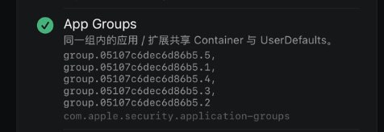
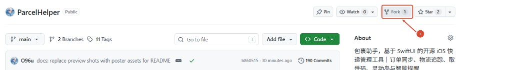
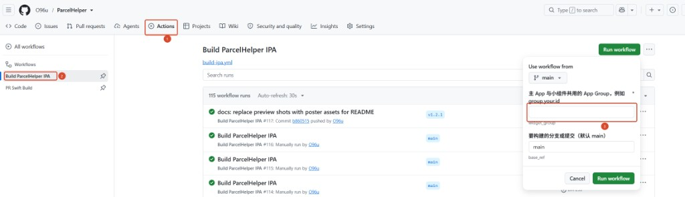

> **置顶说明**：自签后桌面小组件不可用，多半是 IPA 里写入的 App Group 与证书不一致。按下列 **图文步骤** 用你自己的 `group.xxx` 构建一次 **预发布 IPA** 即可（Pre-release，不会覆盖 Latest）。

## 为什么会这样？

[最新正式版 Release](https://github.com/O96u/ParcelHelper/releases/latest) 里嵌入的多为**示例**组 `group.com.muxui.ParcelHelper`。你用 LCSign 等自签时，描述文件里是**另一串** `group.xxx`，主 App 与小组件扩展就**无法共享数据**，表现为小组件空白、设置里「当前签名可访问」不可用。

---

## 步骤一：在签名工具里找到自己的 App Group

打开签名工具中**正在使用的证书 / 描述文件**，找到 **App Groups**（底层键名为 `com.apple.security.application-groups`）。复制其中**一个**你实际拥有的组 ID（须以 `group.` 开头）。

  

示例：`group.05107c6dec6d86b5.5`（**请用你自己证书里的值，不要照抄截图**）。

重签安装时：**主 App** 与 **Widget 扩展（.appex）** 都必须保留**同一个** App Group。

---

## 步骤二：打开仓库并进入 Actions

在 GitHub 打开 [O96u/ParcelHelper](https://github.com/O96u/ParcelHelper)，顶栏点 **Actions**。

  

---

## 步骤三：手动运行构建并填写 widget_group

1. 左侧点 **Build ParcelHelper IPA**
2. 右侧点 **Run workflow**
3. 在 **`widget_group`** 粘贴步骤一复制的完整组名
4. `base_ref` 一般保持 `main`，点绿色 **Run workflow**

  

构建成功后，到 **Releases** 下载对应 **`v*-pre.*` 的 Pre-release**（带 Pre-release 标记，不是 Latest），获取 `ParcelHelper.ipa`。

快捷入口：[Build ParcelHelper IPA 工作流](https://github.com/O96u/ParcelHelper/actions/workflows/build-ipa.yml)

---

## 步骤四：自签、安装并检查

- 用签名工具安装，**务必保留小组件扩展**，且 entitlement 里仍有同一 App Group。
- 打开 App **设置 → 小组件**，确认「当前签名可访问」；需要时点「重新写入小组件数据」。

---

## 仍无法使用？

请用 [Bug 报告模板](https://github.com/O96u/ParcelHelper/issues/new?template=bug_report.yml) 反馈（勿上传证书、Cookie），并说明构建时填写的 `group.xxx` 与描述文件是否一致。

更多细节：[docs/widget-signing.md](https://github.com/O96u/ParcelHelper/blob/main/docs/widget-signing.md) · 本教程图源：[docs/guide/widget-self-sign/](https://github.com/O96u/ParcelHelper/tree/main/docs/guide/widget-self-sign)